# P1 第7章 Radians · 本批21题与建议评分

题目为原创变式；来源及难度定位放在答案内。评分点是建议分值，等价正确解法应予认可。

## P1-C07-R01 · P1 第7章 · 对称拼接的逆向条件与等面积比较 · 10 marks

A stage consists of a sector $OBC$ and two congruent triangles $OAB$ and $OCD$, attached outside the sector. The points $A,O,D$ lie on a straight line in that order, $OA=OD=x$ m and $OB=OC=r$ m, where $x,r>0$. The angle $BOC$ is $\pi/3$ radians and $AB=CD=r$. The total area is $(18\sqrt3+6\pi)\text{ m}^2$.<figure class="rewrite-figure">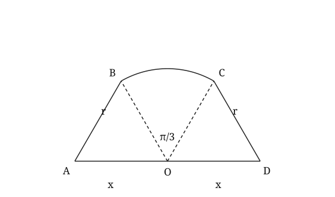<figcaption>Diagram not necessarily drawn to scale</figcaption></figure>

**(a)** Find the exact values of $r$ and $x$. **[5]**

**(b)** A second design has $\angle BOC=2\pi/3$ radians. It has the same total area and again satisfies $AB=CD=r$, but its values of $r$ and $x$ may differ. Determine which design has the smaller perimeter, giving each perimeter to 3 significant figures. **[5]**

### 答案与解析

略难于 P1-2024-06R-Q06：用相等边的隐含条件重建尺寸，再在同面积约束下重新缩放第二种几何设计

**变式来源：** P1-2024-06R-Q06。原题大意：扇形与全等侧三角形：证明角、求外周界和面积。

**改编维度：** 设问角度、条件呈现、求解目标、题目结构、跨考点耦合。

**保留的考点本质：** 对称角关系、余弦定理和拼接后真正的外边界。

**(a) 答案：** $r=x=6$.

1. 先由直线角及对称性求侧角：$\angle AOB=(\pi-\pi/3)/2=\pi/3$。
2. 余弦定理和 $AB=r$ 给出 $r^2=x^2+r^2-xr$，故 $x(x-r)=0$。因 $x>0$，只能 $x=r$。
3. 总面积为 $\frac12r^2(\pi/3)+2(\frac12r^2\sin(\pi/3))=r^2(\pi/6+\sqrt3/2)$。
4. 与给定面积比较得 $r^2=36$；两长度均为正，故 $r=x=6$。

建议评分：B1 [1] 由对称和直线角确定侧角；M1 [1] 把AB=r代入余弦定理；A1 [1] 排除x=0并得x=r；M1 [1] 建立完整面积方程；A1 [1] 取得正确的正半径和侧边。

**(b) 答案：** 第一种周界 $=30.3$ m；第二种 $=38.7$ m，第一种较小。

1. 第二种侧角为 $\pi/6$；余弦定理给 $x=2r\cos(\pi/6)=\sqrt3r$。
2. 面积条件变为 $r^2(\pi/3+\sqrt3/2)=18\sqrt3+6\pi$，由此求第二种正半径。
3. 周界只含两斜边、圆弧和底边，统一为 $P=2r+r\theta+2x$，不含两条内部半径。
4. 第一种 $P=24+2\pi=30.283185\ldots$；第二种正半径为 $5.113487\ldots$，周界为 $38.650273\ldots$。
5. 按未舍入值比较，并将两个周界各取3位有效数字。

建议评分：M1 [1] 从新角度重新得到x与r的关系；M1 [1] 按相同总面积反求新的尺度；M1 [1] 正确构造外周界；A1 [1] 两个周界正确；B1 [1] 比较方向及3位有效数字正确。

**易错点与命题思路：**

- AB=r并不意味着可以直接假定x=r，须证明并排除零长度。
- 第二种设计的半径会改变，不能直接比较圆心角。
- 用相等边的隐含条件重建尺寸，再在同面积约束下重新缩放第二种几何设计。保留来源题的对称角关系、余弦定理和拼接后真正的外边界。

## P1-C07-R02 · P1 第7章 · 同心组合扇形的逆求与边界替换 · 9 marks

A platform consists of a major sector of radius $r$ cm and angle $2\pi-\theta$, joined to a minor sector of radius $2r$ cm and angle $\theta$, where $r>0$ and $0<\theta<\pi$. Their centres are both $O$ and the two radial directions are common. The two sectors have disjoint interiors. The longer-radius arc has length $4\pi$ cm and the total area is $54\pi\text{ cm}^2$.<figure class="rewrite-figure">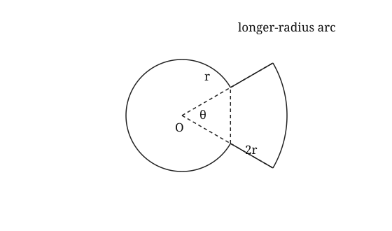<figcaption>Diagram not necessarily drawn to scale</figcaption></figure>

**(a)** Find $r$ and $\theta$, giving exact answers. **[4]**

**(b)** The major arc of the smaller circle is replaced by the straight chord joining its endpoints. The boundary using the larger-radius arc is retained. Find the exact reductions in the area and in the perimeter of the platform. **[5]**

### 答案与解析

略难于 P1-2024-01-Q08：逆用整体面积和外弧条件求尺度，再识别大弧换弦实际切掉的大弓形

**变式来源：** P1-2024-01-Q08。原题大意：同心不同半径的扇形平台：由弧长及比例求半径、完整周界与面积。

**改编维度：** 设问角度、条件呈现、求解目标、题目结构、收尾要求。

**保留的考点本质：** 不同半径对应的角、组合面积及两段径向边界。

**(a) 答案：** $r=6\text{ cm},\quad\theta=\pi/3$.

1. 长半径的弧满足 $2r\theta=4\pi$，即 $r\theta=2\pi$。
2. 两部分面积相加：$54\pi=\frac12r^2(2\pi-\theta)+\frac12(2r)^2\theta=\pi r^2+\frac32r^2\theta$。
3. 消去 $\theta$ 后得 $r^2+3r-54=(r+9)(r-6)=0$。
4. 负半径舍去；$r=6$，继而 $\theta=\pi/3$，确在指定范围。

建议评分：M1 [1] 由外弧长建立方程；M1 [1] 建立不重叠组合面积方程；M1 [1] 消元并求二次方程；A1 [1] 选择正根并给正确角。

**(b) 答案：** 面积减少 $(30\pi+9\sqrt3)\text{ cm}^2$；周界减少 $(10\pi-6)\text{ cm}$。

1. 替换的原弧为小圆的大弧，角为 $5\pi/3$；新弦长为 $2(6)\sin(\pi/6)=6$。
2. 周界其余部分不变，减少量是 $6(5\pi/3)-6=10\pi-6$。
3. 被截去的是大弓形，而非小弓形：面积为大扇形加对应等腰三角形。
4. $\Delta A=\frac12(6)^2(5\pi/3)+\frac12(6)^2\sin(\pi/3)=30\pi+9\sqrt3$。

建议评分：M1 [1] 正确求替代弦长；A1 [1] 正确的周界减少量；B1 [1] 识别被去掉的是大弓形；M1 [1] 大扇形与三角形相加；A1 [1] 正确的精确面积减少量。

**易错点与命题思路：**

- 两扇形面积相加，不是同角的外扇形减内扇形。
- 换掉大弧时，面积损失是大弓形，不能使用小弓形公式。
- 逆用整体面积和外弧条件求尺度，再识别大弧换弦实际切掉的大弓形。保留来源题的不同半径对应的角、组合面积及两段径向边界。

## P1-C07-R03 · P1 第7章 · 面积比反求角 · 7 marks

All angles in this question are measured in radians. A sector of radius $r$ cm, where $r>0$, has angle $\theta$, where $0<\theta<\pi$. Its area is three times the area of the triangle formed by its radii and chord.<figure class="rewrite-figure"><svg xmlns="http://www.w3.org/2000/svg" viewBox="0 0 420 270" role="img" aria-label="Sector OAB with chord AB; centre O"><path d="M160 200L280 200A120 120 0 0 0 81.95630637536588 108.84528599450138Z M280 200L81.95630637536588 108.84528599450138" fill="none" stroke="#222" stroke-width="2"/><text x="140" y="220">O</text><text x="285" y="220">A</text><text x="69.95630637536588" y="98.84528599450138">B</text><text x="175" y="185">θ</text><text x="15" y="255">Not to scale; angles in radians</text></svg><figcaption>Diagram not necessarily drawn to scale</figcaption></figure>

**(a)** Show that $\theta=3\sin\theta$. **[2]**

**(b)** Given $\theta=2.27886$ to 5 decimal places, find the ratio arc length:chord length to 3 significant figures. **[2]**

**(c)** If $r=5$, find the segment area to 3 significant figures. **[3]**

### 答案与解析

略难于 P1-2022-01-Q05：由面积关系自行建立非线性方程，并在给根后完成弧弦比和弓形面积。

**变式来源：** P1-2022-01-Q05。原题大意：半圆内弓形：证明圆心角、求弓形面积及含弧周界。

**改编维度：** 设问角度、求解目标、条件呈现、题目结构。

**保留的考点本质：** 弧度制下扇形面积、三角形面积、弦长与弓形面积的连接。

**(a) 答案：** 两面积分别为$\frac12r^2\theta$及$\frac12r^2\sin\theta$。

1. 扇形面积为 $\frac12r^2\theta$，三角形面积为 $\frac12r^2\sin\theta$。
2. 由“前者为后者的三倍”，有 $\frac12r^2\theta=3\times\frac12r^2\sin\theta$。
3. 因 $r>0$，约去 $r^2/2$，得 $\theta=3\sin\theta$。

建议评分：M1 [1] Equates the sector area to three times the triangle area；A1 [1] Cancels the valid non-zero factor and obtains θ=3 sin θ。

**(b) 答案：** $1.25:1$.

1. 平分等腰三角形得到半角直角三角形，因此弦长为 $2r\sin(\theta/2)$。
2. 比值$\theta/(2\sin(\theta/2))$。
3. $1.25:1$.

建议评分：M1 [1] Uses arc rθ and chord 2r sin(θ/2)；A1 [1] Obtains 1.25:1 to 3 significant figures。

**(c) 答案：** $19.0\text{ cm}^2$.

1. 同一圆心角为 $\theta$ 时，扇形面积为 $\frac12r^2\theta$，对应三角形面积为 $\frac12r^2\sin\theta$。
2. 段面积$\frac12r^2(\theta-\sin\theta)$。
3. 由前问可写$r^2\theta/3$。
4. $19.0$.

建议评分：M1 [1] Uses 1/2 r²(θ−sinθ)；A1 [1] Substitutes r=5 and the supplied root；A1 [1] Obtains 19.0 square units to 3 significant figures。

**易错点与命题思路：**

- 方程中的正弦角是 θ，而弦长公式使用 θ/2。
- 给定数值根并不免除前问建立方程的过程。
- 把给角计算改成由面积比反推隐式方程，并加入无量纲弧弦比。

## P1-C07-R07 · P1 第7章 · 同弦在两圆中的弓形比较 · 10 marks

In a circle with centre $O$, $OA=OB=10$ cm and the chord $AB$ has length $12$ cm. The minor angle $AOB$ is $\theta$ radians.<figure class="rewrite-figure"><svg xmlns="http://www.w3.org/2000/svg" viewBox="0 0 540 300" role="img" aria-label="A chord in a circle"><title>A chord in a circle</title><g fill="none" stroke="#222" stroke-width="1.6"><circle cx="270" cy="155" r="115"/><path d="M170 98L370 98M270 155L170 98M270 155L370 98"/><text x="263" y="178" fill="#222" stroke="none" font-family="Georgia,serif" font-size="16">O</text><text x="150" y="94" fill="#222" stroke="none" font-family="Georgia,serif" font-size="16">A</text><text x="380" y="94" fill="#222" stroke="none" font-family="Georgia,serif" font-size="16">B</text></g></svg><figcaption>Diagram not necessarily drawn to scale</figcaption></figure>

**(a)** Show that $\cos\theta=\dfrac7{25}$ and find $\theta$ to 3 decimal places. **[3]**

**(b)** Find the area of the minor segment bounded by $AB$ and the minor arc. **[3]**

**(c)** In a second circle the same chord $AB$ subtends the angle $\theta/2$. Find the radius of the second circle to 3 significant figures and determine which minor segment has the greater area. **[4]**

### 答案与解析

略难于 P1-2022-01-Q05：由弦逆求角，再对同一弦在第二个圆中的半角构造反求新半径，比较两弓形

**变式来源：** P1-2022-01-Q05。原题大意：半圆内给定边角关系求圆心角，再求弓形面积和含弦周界。

**改编维度：** 设问角度、求解目标、条件呈现、收尾要求。

**保留的考点本质：** 由弦确定圆心角，再连接弓形面积。

**(a) 答案：** $\cos\theta=7/25$, $\theta=1.287$ radians.

1. 对三角形 $AOB$ 用余弦定理：$12^2=10^2+10^2-2(10)(10)\cos\theta$。
2. 整理得 $\cos\theta=7/25$，所以 $\theta=1.287\ldots$。

建议评分：M1 [1] Applies the cosine rule；A1 [1] Obtains cos θ=7/25；A1 [1] Obtains θ=1.287 radians。

**(b) 答案：** $16.4\text{ cm}^2$.

1. 小弓形面积为扇形减三角形：$A=\tfrac12(10)^2(\theta-\sin\theta)$。
2. 代入未舍入的 $\theta$，得 $A=16.350111\ldots\text{ cm}^2$。

建议评分：M1 [1] Subtracts the isosceles triangle from the sector；A1 [1] Uses the unrounded angle；A1 [1] Gives the correct area to 3 significant figures。

**(c) 答案：** 半径 $19.0$ cm（3 s.f.）；第一个小弓形面积较大（$16.4>7.83$）。

1. 第二个圆中 $12=2R\sin(\theta/4)$，故 $R=6/\sin(\theta/4)=18.973666\ldots$ cm。
2. 第二个小弓形面积为 $\tfrac12R^2(\theta/2-\sin(\theta/2))=7.830200\ldots$。
3. 比较 $16.350111\ldots$ 与 $7.830200\ldots$，第一个弓形面积较大。

建议评分：M1 [1] Builds the half-angle chord equation；A1 [1] Finds the second radius；M1 [1] Calculates the second segment area；A1 [1] Makes the correct comparison。

**易错点与命题思路：**

- 弦公式使用半圆心角
- 第二个圆半径较大并不保证弓形面积较大。
- 由弦逆求角，再对同一弦在第二个圆中的半角构造反求新半径，比较两弓形；不将半角的范围选择误称为正弦定理SSA钝角取舍。

## P1-C07-R08 · P1 第7章 · 双半径风扇的单元数反求与等周缩放 · 10 marks

A flat fan is made from $n$ identical angular cells arranged around a common centre, with no gaps between cells. Each cell consists of a sector of radius $2$ cm and angle $\alpha$, followed by a sector of radius $8$ cm and angle $\beta$, where $\alpha,\beta>0$ and $\alpha+\beta=2\pi/n$. The cells form one connected shape. Its area is $(64\pi-90)\text{ cm}^2$ and its perimeter is $(16\pi+30)$ cm.<figure class="rewrite-figure">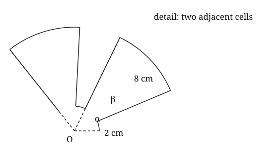<figcaption>Diagram not necessarily drawn to scale</figcaption></figure>

**(a)** Determine $n$ and $\alpha$. Explain why your values describe a valid fan. **[6]**

**(b)** A second fan has five cells and the same value of $\alpha$. Before scaling, its two radii are also $2$ cm and $8$ cm. It is then scaled uniformly so that its perimeter equals that of the first fan. Find the ratio of its final area to the area of the first fan, giving your answer in the form $k:1$, where $k$ is correct to 3 significant figures. **[4]**

### 答案与解析

略难于 P1-2022-06-Q08：将已知单元数改为由面积与周界同时反求，并比较改变单元数后等周缩放的面积

**变式来源：** P1-2022-06-Q08。原题大意：两种半径的重复扇形风扇：由整周关系求弧长、总周界和总面积。

**改编维度：** 设问角度、条件呈现、求解目标、参数化与分类讨论、跨考点耦合。

**保留的考点本质：** 重复单元的整周角、不同半径面积和外露的径向阶差。

**(a) 答案：** $n=4,\quad\alpha=3/4$；$\beta=\pi/2-3/4>0$.

1. 利用 $n\beta=2\pi-n\alpha$，面积方程为 $2n\alpha+32n\beta=64\pi-90$，故 $n\alpha=3$。
2. 每个单元外露两弧及两条长 $8-2=6$ 的径向阶差；公共的内侧半径在内部。
3. 周界为 $2n\alpha+8n\beta+12n=16\pi-6n\alpha+12n$。
4. 代入 $n\alpha=3$ 及给定周界，得 $n=4$，$\alpha=3/4$。
5. 验证 $n$ 为正整数且 $\beta=\pi/2-3/4>0$，整周角条件确实满足。

建议评分：M1 [1] 正确写出重复单元总面积；A1 [1] 由面积得到nα=3；M1 [1] 识别每单元两段径向阶差；M1 [1] 建立完整周界方程；A1 [1] 解得n及α；B1 [1] 核查整数和正角条件。

**(b) 答案：** $0.667:1$.

1. 五单元方案有 $n\alpha=15/4$，其未缩放面积为 $64\pi-112.5$，周界为 $16\pi+37.5$。
2. 等周界的线性缩放因子为 $s=(16\pi+30)/(16\pi+37.5)$；面积须乘 $s^2$。
3. 所求比值 $k=s^2(64\pi-112.5)/(64\pi-90)=0.66694805\ldots$。
4. 验证五单元的另一个角 $2\pi/5-3/4>0$，并按要求给出面积比。

建议评分：M1 [1] 重建五单元方案面积与周界；M1 [1] 用周界确定线性缩放因子；M1 [1] 对面积使用缩放因子的平方；A1 [1] 正确面积比及有效方案。

**易错点与命题思路：**

- 内部半径不属于外边界，但每次高低半径交替产生的6 cm边必须计入。
- 统一缩放时，面积乘s²而不是s。
- 将已知单元数改为由面积与周界同时反求，并比较改变单元数后等周缩放的面积。保留来源题的重复单元的整周角、不同半径面积和外露的径向阶差。

## P1-C07-R10 · P1 第7章 · 固定周界下两种小扇形的面积范围 · 8 marks

A minor sector has radius $r$ cm, angle $\theta$ radians, perimeter $20$ cm and area $A\text{ cm}^2$, where $r>0$ and $0<\theta<\pi$.

**(a)** Show that $A\le25$ and find the radius and angle when equality holds. **[3]**

**(b)** Find the exact range of $A$ for which two distinct minor sectors have this perimeter and this area. Justify both ends of your range. **[5]**

### 答案与解析

略难于 P1-2019-01-Q10：把一次求两根升级为整段面积参数的双解分类，并处理π边界和重根

**变式来源：** P1-2019-01-Q10。原题大意：给定扇形面积和周界，建立角的二次方程并找全部半径与角的配对。

**改编维度：** 求解目标、条件呈现、参数化与分类讨论、收尾要求。

**保留的考点本质：** 同时使用扇形面积和完整周界，保留并检验所有几何解。

**(a) 答案：** $A\le25$；等号时 $r=5,\theta=2$.

1. 周界条件给 $r\theta=20-2r$，所以 $A=\frac12r(r\theta)=10r-r^2$。
2. 配方得 $A=25-(r-5)^2\le25$。
3. 等号时 $r=5$，由周界得 $\theta=2$；该角在 $(0,\pi)$ 内。

建议评分：M1 [1] 从周界消去角得到面积表达式；M1 [1] 通过配方证明上界；A1 [1] 等号时两参数正确并满足minor范围。

**(b) 答案：** $\displaystyle\frac{200\pi}{(\pi+2)^2}<A<25$.

1. 由 $0<20/r-2<\pi$ 得 $20/(\pi+2)<r<10$。
2. 当 $A<25$ 时，两个可能半径为 $5-\sqrt{25-A}$、$5+\sqrt{25-A}$。
3. 要两根都可用，较小根必须严格大于 $20/(\pi+2)$；较大根随后自动小于10。
4. 令边界较小根为 $20/(\pi+2)$，相应 $A=r(10-r)=200\pi/(\pi+2)^2$。
5. 下界使一解角等于π，已不再是minor；上界两根合并，故两端均不取。

建议评分：M1 [1] 取得半径的几何有效区间；M1 [1] 表达二次方程的两根；M1 [1] 将两根可用化为较小根的严格限制；A1 [1] 精确面积下界正确；B1 [1] 解释两端均须排除。

**易错点与命题思路：**

- 二次方程有两个正根，不等于有两个有效minor sectors。
- A=25只有一个扇形；较小角的相应根配对不能弄反。
- 把一次求两根升级为整段面积参数的双解分类，并处理π边界和重根。保留来源题的同时使用扇形面积和完整周界，保留并检验所有几何解。

## P1-C07-R11 · P1 第7章 · 面积比反求内扇形半径 · 9 marks

Triangle $ABC$ has $AB=8$ cm, $AC=11$ cm and $\angle BAC=1.2$ radians. A sector with centre $A$, radius $r$ cm and angle $1.2$ radians is removed from the corner. The area left is twice the area of the sector.<figure class="rewrite-figure"><svg xmlns="http://www.w3.org/2000/svg" viewBox="0 0 540 300" role="img" aria-label="A sector removed from a triangle"><title>A sector removed from a triangle</title><g fill="none" stroke="#222" stroke-width="1.6"><path d="M90 245L435 245L210 65Z"/><path d="M90 245L245 175A170 170 0 0 1 90 75Z" transform="rotate(0 90 245)"/><text x="72" y="268" fill="#222" stroke="none" font-family="Georgia,serif" font-size="16">A</text><text x="445" y="268" fill="#222" stroke="none" font-family="Georgia,serif" font-size="16">B</text><text x="203" y="55" fill="#222" stroke="none" font-family="Georgia,serif" font-size="16">C</text></g></svg><figcaption>Diagram not necessarily drawn to scale</figcaption></figure>

**(a)** Show that $r^2=\dfrac{220}{9}\sin1.2$ and find $r$ to 3 significant figures. **[3]**

**(b)** Find the perpendicular distance from $A$ to $BC$ and hence justify that the complete sector lies inside the triangle. **[3]**

**(c)** Find the perimeter of the remaining region to 3 significant figures. **[3]**

### 答案与解析

略难于 P1-2024-06-Q05：由面积比反求半径，并要求用垂距证明几何内含

**变式来源：** P1-2024-06-Q05。原题大意：扇形、三角形角度与组合面积。

**改编维度：** 设问角度、条件呈现、跨考点耦合、收尾要求。

**保留的考点本质：** 扇形与三角形面积、余弦定理和真实边界。

**(a) 答案：** $r=4.77$ cm.

1. 三角形面积为 $\tfrac12(8)(11)\sin1.2=44\sin1.2$。
2. 剩余面积是扇形的两倍，所以三角形总面积是扇形面积的三倍：$44\sin1.2=3(0.6r^2)$。
3. 因此 $r^2=\dfrac{220}{9}\sin1.2$，$r=4.773173\ldots$ cm。

建议评分：M1 [1] Forms the triangle and sector areas；M1 [1] Uses the stated area ratio；A1 [1] Obtains the required expression and radius。

**(b) 答案：** Distance $=7.45$ cm, which is greater than $r$, so the sector lies inside.

1. 余弦定理给出 $BC=\sqrt{8^2+11^2-2(8)(11)\cos1.2}=11.010224\ldots$。
2. 由 $\tfrac12BC\,h=44\sin1.2$ 得 $h=7.449389\ldots$ cm。
3. 因为 $r<h$ 且 $r<8,11$，圆弧不会穿过三角形任一边。

建议评分：M1 [1] Finds BC and uses triangle area to obtain the altitude；A1 [1] Obtains the perpendicular distance；A1 [1] Gives a valid containment justification。

**(c) 答案：** $26.2$ cm.

1. 外露直边为 $(8-r)+(11-r)+BC$，还要加上新形成的弧 $1.2r$。
2. $P=19+BC-0.8r=26.191686\ldots$ cm。

建议评分：M1 [1] Identifies the two shortened sides, BC and the new arc；M1 [1] Forms the complete perimeter；A1 [1] Gives the perimeter to 3 significant figures。

**易错点与命题思路：**

- 面积比是“余下:扇形=2:1”
- 只检查r小于两邻边不足以证明圆弧不越过BC。
- 由面积比反求半径，并要求用垂距证明几何内含

## P1-C07-R13 · P1 第7章 · 大扇形平台的存在范围与钝角取舍 · 11 marks

A platform is formed from a major sector of a circle, centre $O$ and radius $6$ m, joined to triangle $AOD$. Points $O,C,D$ lie on one ray in that order, $OC=OA=6$ m, $AD=d$ m and $\angle ADO=\pi/6$. The angle $AOD$ must be obtuse. The major arc from $A$ to $C$ is denoted by arc $ABC$. The outside boundary is arc $ABC$, $CD$ and $DA$.<figure class="rewrite-figure">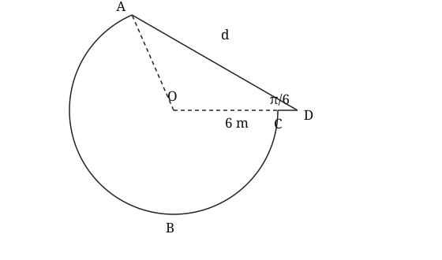<figcaption>Diagram not necessarily drawn to scale</figcaption></figure>

**(a)** Find the complete range of $d$ for which this platform exists. Your answer must take account of both the obtuse angle and the order of $O,C,D$. **[5]**

**(b)** For $d=11$, find the total area and the perimeter of the platform, giving each answer to 3 significant figures. **[6]**

### 答案与解析

略难于 P1-2021-01-Q05：先证明平台存在的完整参数区间，尤其增加OD大于半径的非退化限制，再完成有效设计的面积周界

**变式来源：** P1-2021-01-Q05。原题大意：正弦定理选择钝角，求大弧长及三角形与扇形的组合面积。

**改编维度：** 求解目标、条件呈现、参数化与分类讨论、题目结构、收尾要求。

**保留的考点本质：** SSA的角支选择、大扇形及共线部分边界。

**(a) 答案：** $6\sqrt3<d<12$.

1. 正弦定理给 $\sin\angle AOD=d/12$。取钝角时 $\angle AOD=\pi-\sin^{-1}(d/12)$，且 $d<12$，不能把直角端点包括进来。
2. 令 $\gamma=\sin^{-1}(d/12)$，则 $\angle OAD=\gamma-\pi/6$。
3. 由正弦定理，$OD=12\sin(\gamma-\pi/6)$。要求 $D$ 在 $C$ 外侧，即 $OD>6$。
4. 三角形存在须有 $\angle OAD>0$；在此范围内 $0<\gamma-\pi/6<\pi/3$，正弦递增；$OD>6$ 等价于 $\gamma-\pi/6>\pi/6$。
5. 故 $\gamma>\pi/3$，即 $d>12\sin(\pi/3)=6\sqrt3$；结合上界得所求严格区间。

建议评分：M1 [1] 用正弦定理并选择钝角支；A1 [1] 钝角给出严格上界；M1 [1] 将共线顺序转化为OD>6；M1 [1] 正确比较角或构造边界三角形；A1 [1] 取得完整严格区间。

**(b) 答案：** 面积 $97.0\text{ m}^2$；周界 $37.9$ m。

1. 取钝角 $\omega=\pi-\sin^{-1}(11/12)=1.98193419\ldots$。
2. $OD=12\sin(\pi-\omega-\pi/6)=7.12836368\ldots$，确大于6。
3. 大扇形角为 $2\pi-\omega$；三角形与大扇形的内部互不重叠。
4. $A=18(2\pi-\omega)+3OD\sin\omega=97.02552025\ldots$。
5. $P=6(2\pi-\omega)+(OD-6)+11=37.93587039\ldots$；公共半径OA及OC不计。

建议评分：M1 [1] 正确选择所需钝角；A1 [1] 取得OD的正确长度；M1 [1] 正确构造大扇形和三角形总面积；A1 [1] 总面积正确；M1 [1] 正确构造外弧及两段直边；A1 [1] 周界正确并按3位有效数字作答。

**易错点与命题思路：**

- 只写d<12会漏掉D必须在C外侧的限制。
- 下界OD=OC使D和C重合，上界使AOD为直角，两端均不可取。
- 先证明平台存在的完整参数区间，尤其增加OD大于半径的非退化限制，再完成有效设计的面积周界。保留来源题的SSA的角支选择、大扇形及共线部分边界。

## P1-C07-R20 · P1 第7章 · 标志的两种逆向设计与未舍入比较 · 10 marks

A sign consists of triangle $CPQ$ joined to a major sector of a circle with centre $C$. The sector has radius $CQ=\sqrt{17}/2$ m. A point $T$ lies on $CP$ with $CT=CQ$, and the major sector has endpoints $Q$ and $T$. The triangle and sector have disjoint interiors. Given that $PC=4$ m and $\angle QPC=\pi/6$, the outside boundary is $PQ$, $PT$ and the major arc $QT$.<figure class="rewrite-figure">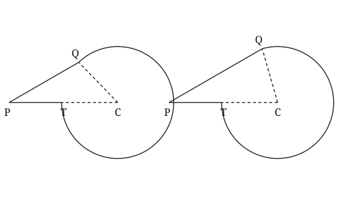<figcaption>Diagram not necessarily drawn to scale</figcaption></figure>

**(a)** Find both possible exact lengths of $PQ$ and explain why both give valid signs. **[5]**

**(b)** Determine which sign has the greater area and which has the greater perimeter. Give each area and perimeter to 3 significant figures, but use unrounded values to make your comparisons. **[5]**

### 答案与解析

略难于 P1-2025-06A-Q09：把已知半径改为反求两种三角形设计，并比较舍入后周界相同但实际不同的两种有效方案

**变式来源：** P1-2025-06A-Q09。原题大意：三角形与大扇形标志：求半径、证明角度、求总面积与周界。

**改编维度：** 设问角度、求解目标、条件呈现、题目结构、收尾要求。

**保留的考点本质：** 三角形确定大扇形角及共边之外的外周界。

**(a) 答案：**  $PQ=2\sqrt3-1/2$ m 或 $2\sqrt3+1/2$ m；两种均有效。

1. 设 $PQ=x$。余弦定理为 $17/4=16+x^2-8x\cos(\pi/6)$，即 $x^2-4\sqrt3x+47/4=0$。
2. 配方得 $(x-2\sqrt3)^2=1/4$，故两根为 $2\sqrt3\pm1/2$。
3. 两正根都满足三角形不等式；$CQ=\sqrt{17}/2<PC=4$，所以两种设计的T均在线段CP内部。
4. 由两根各求得的角 $PCQ$ 均在 $(0,\pi)$，相应大扇形与三角形可位于共边的两侧，不能无理由删去一根。

建议评分：M1 [1] 正确建立逆向余弦定理二次方程；M1 [1] 正确解出两根；A1 [1] 两条精确长度正确；B1 [1] 验证三角形及T在线段内；B1 [1] 解释两种角及大扇形均有效。

**(b) 答案：** $PQ=2\sqrt3-1/2$ 的面积及周界都较大；两方案面积依次为 $14.6,\ 14.6\text{ m}^2$，周界依次为 $16.2,\ 16.2$ m。

1. 对每个x分别由余弦定理求 $\theta=\angle PCQ$，而不是把一组角代入另一组。
2. 总面积 $A=\frac{17}{8}(2\pi-\theta)+x$；外周界 $P=(\sqrt{17}/2)(2\pi-\theta)+x+4-\sqrt{17}/2$。
3. 当 $x=2\sqrt3-1/2$：$\theta=0.802218888\ldots$，$A=14.611155256\ldots$，$P=16.201850541\ldots$。
4. 当 $x=2\sqrt3+1/2$：$\theta=1.292176214\ldots$，$A=14.569995937\ldots$，$P=16.191777636\ldots$。
5. 按未舍入值比较：较短PQ的方案两项都较大；周界在3位有效数字下会相同，不能据此判为实际相等。

建议评分：M1 [1] 分别求两种圆心角；M1 [1] 构造正确总面积；M1 [1] 排除共边并构造正确完整周界；A1 [1] 两组数值及精度正确；B1 [1] 用未舍入值作出两个正确比较。

**易错点与命题思路：**

- 给定半径和角不保证PQ唯一。
- 较长的PQ并不保证整体周界更长；3位有效数字相同不能判相等。
- 把已知半径改为反求两种三角形设计，并比较舍入后周界相同但实际不同的两种有效方案。保留来源题的三角形确定大扇形角及共边之外的外周界。

## P1-C07-R21 · P1 第7章 · 同弦大小弓形的选择与证明 · 11 marks

A chord $AB$ of a circle of radius $9$ cm has length $14$ cm. It divides the circle into a minor segment $S$ and a major segment $T$. Let the minor angle $AOB$ be $\theta$ radians.<figure class="rewrite-figure"><svg xmlns="http://www.w3.org/2000/svg" viewBox="0 0 540 300" role="img" aria-label="Minor and major segments cut by one chord"><title>Minor and major segments cut by one chord</title><g fill="none" stroke="#222" stroke-width="1.6"><circle cx="270" cy="155" r="115"/><path d="M170 98L370 98M270 155L170 98M270 155L370 98"/><text x="263" y="178" fill="#222" stroke="none" font-family="Georgia,serif" font-size="16">O</text><text x="150" y="94" fill="#222" stroke="none" font-family="Georgia,serif" font-size="16">A</text><text x="380" y="94" fill="#222" stroke="none" font-family="Georgia,serif" font-size="16">B</text></g></svg><figcaption>Diagram not necessarily drawn to scale</figcaption></figure>

**(a)** Find $\theta$ to 3 decimal places and explain why the other solution of $\sin(\theta/2)=7/9$ is not used for the minor angle. **[3]**

**(b)** Find the areas of $S$ and $T$, giving each to 3 significant figures. **[3]**

**(c)** Show that the difference between the perimeters of $T$ and $S$ is $18(\pi-\theta)$, and find this difference. Hence determine whether the area ratio $T:S$ is greater than the perimeter ratio $P_T:P_S$. **[5]**

### 答案与解析

略难于 P1-2022-01-Q05：由弦逆求角，证明同弦大小弓形的周界差，并比较面积比与周界比

**变式来源：** P1-2022-01-Q05。原题大意：半圆内给定边角关系求圆心角，再求弓形面积和含弦周界。

**改编维度：** 设问角度、求解目标、条件呈现、收尾要求。

**保留的考点本质：** 角的有效范围决定大小弧与弓形。

**(a) 答案：** $\theta=1.782$ radians; the other value gives an angle greater than $\pi$.

1. $14=2(9)\sin(\theta/2)$，所以 $\sin(\theta/2)=7/9$。
2. 小圆心角为 $\theta=1.782245\ldots<\pi$；补角解会使 $\theta>\pi$，不符合“小角”。

建议评分：M1 [1] Forms the half-angle chord equation；A1 [1] Finds the minor angle；A1 [1] Rejects the non-minor alternative correctly。

**(b) 答案：** $S=32.6\text{ cm}^2$, $T=222\text{ cm}^2$.

1. 小弓形面积为 $A_S=\tfrac12(9)^2(\theta-\sin\theta)=32.582943\ldots$。
2. 大弓形是整圆减去小弓形，所以 $A_T=81\pi-A_S=221.886062\ldots$。

建议评分：M1 [1] Finds the minor segment area；M1 [1] Subtracts from the circle area；A1 [1] Gives both areas to 3 significant figures。

**(c) 答案：** $18(\pi-\theta)=24.5$ cm. Yes; compare the two ratios using unrounded values.

1. 两种弓形的周长都含同一条弦，相减时弦长抵消。
2. 两段弧长之差为 $9(2\pi-\theta)-9\theta=18(\pi-\theta)=24.468257\ldots$ cm。
3. $T:S=6.809884\ldots$，而 $P_T:P_S=1.814517\ldots$，所以面积比更大。

建议评分：B1 [1] Recognises that the chord cancels；M1 [1] Subtracts major and minor arc lengths；A1 [1] Obtains the stated form and numerical value；M1 [1] Forms both ratios with the common chord included in each perimeter；A1 [1] States the correct comparison。

**易错点与命题思路：**

- 求弦长反角时需检查minor范围
- 比较周长时弦在两边都必须保留。
- 由弦逆求角，证明同弦大小弓形的周界差，并比较面积比与周界比；不将半角的范围选择误称为正弦定理SSA钝角取舍。

## P1-C07-R23 · P1 第7章 · 环形面积弧差约束下的周界下界 · 10 marks

An annular sector has inner radius $r$ cm, outer radius $R$ cm and angle $\theta$ radians, where $0<r<R$ and $0<\theta<\pi$. Its area is $30\text{ cm}^2$ and its outer arc is $6$ cm longer than its inner arc. Its complete perimeter is $P$ cm.

**(a)** Show that $R+r=10$ and that $P=10\theta+12/\theta$. State the possible range of $\theta$. **[4]**

**(b)** Prove that $P\ge4\sqrt{30}$ and find the radii and angle when equality holds. **[3]**

**(c)** When $P=26$, find every valid design. Explain why any other algebraic solution is rejected. **[3]**

### 答案与解析

略难于 P1-2023-10-Q09：由面积和弧差提取不变量，证明可达到的周界下界，并排除二次方程的退化几何根

**变式来源：** P1-2023-10-Q09。原题大意：环形扇区由内弧确定内半径，再由面积建立宽度二次方程并求完整周界。

**改编维度：** 设问角度、求解目标、条件呈现、参数化与分类讨论、收尾要求。

**保留的考点本质：** 环形面积差、内外弧长及两条径向宽度。

**(a) 答案：** $R+r=10$；$P=10\theta+12/\theta$；$3/5<\theta<\pi$.

1. 弧长差给 $(R-r)\theta=6$。面积差给 $\frac12(R-r)(R+r)\theta=30$，故 $R+r=10$。
2. 令宽度 $w=R-r=6/\theta$。完整周界含两弧和两宽度，故 $P=(R+r)\theta+2w=10\theta+12/\theta$。
3. $r=(10-w)/2>0$ 要求 $w<10$，故 $\theta>3/5$；并与题设minor范围相交。

建议评分：M1 [1] 结合面积差和弧长差；A1 [1] 正确求出半径和；M1 [1] 完整周界表达式正确；A1 [1] 有效角度范围正确且严格。

**(b) 答案：** 等号时 $\theta=\sqrt{6/5}$，$R=(10+\sqrt{30})/2$，$r=(10-\sqrt{30})/2$.

1. 由于 $\theta>0$，$P-4\sqrt{30}=10(\theta-\sqrt{6/5})^2/\theta\ge0$。
2. 等号当且仅当 $\theta=\sqrt{6/5}$，此时宽度 $w=6/\theta=\sqrt{30}$。
3. 由和与差求两半径；$0<r<R$ 且 $3/5<\sqrt{6/5}<\pi$，所以下界确可达到。

建议评分：M1 [1] 利用非负平方证明周界下界；A1 [1] 取得等号时角及半径；B1 [1] 核查等号设计确在几何有效范围内。

**(c) 答案：** $\theta=2,\ r=7/2,\ R=13/2$；$\theta=3/5$使内半径为0，舍去。

1. $10\theta+12/\theta=26$ 化为 $(5\theta-3)(\theta-2)=0$。
2. 当 $\theta=3/5$ 时宽度为10而半径和也为10，故r=0，已不是环形扇区。
3. 当 $\theta=2$ 时宽度为3，得 $r=7/2,R=13/2$；各约束均满足。

建议评分：M1 [1] 找全角度的两个代数根；B1 [1] 用r=0明确舍去边界根；A1 [1] 给出唯一有效设计。

**易错点与命题思路：**

- r=0的根虽满足形式方程，却不满足annular sector。
- 完整周界中的两条径向边长度是R−r，不是R。
- 由面积和弧差提取不变量，证明可达到的周界下界，并排除二次方程的退化几何根。保留来源题的环形面积差、内外弧长及两条径向宽度。

## P1-C07-R24 · P1 第7章 · 内扇形面积比与极限半径 · 11 marks

Triangle $OAB$ is right-angled at $O$, with $OA=12$ cm and $OB=5$ cm. A sector with centre $O$, angle $\pi/2$ and radius $r$ lies inside the triangle. The area of the sector is one third of the area of the triangle.<figure class="rewrite-figure"><svg xmlns="http://www.w3.org/2000/svg" viewBox="0 0 540 300" role="img" aria-label="A sector inside a right-angled triangle"><title>A sector inside a right-angled triangle</title><g fill="none" stroke="#222" stroke-width="1.6"><path d="M90 245L435 245L210 65Z"/><path d="M90 245L245 175A170 170 0 0 1 90 75Z" transform="rotate(0 90 245)"/><text x="72" y="268" fill="#222" stroke="none" font-family="Georgia,serif" font-size="16">A</text><text x="445" y="268" fill="#222" stroke="none" font-family="Georgia,serif" font-size="16">B</text><text x="203" y="55" fill="#222" stroke="none" font-family="Georgia,serif" font-size="16">C</text></g></svg><figcaption>Diagram not necessarily drawn to scale</figcaption></figure>

**(a)** Find $AB$ and the perpendicular distance from $O$ to $AB$. **[2]**

**(b)** Show that $r=\sqrt{40/\pi}$ and verify that the complete sector lies inside the triangle. **[4]**

**(c)** Find the perimeter of the part of the triangle outside the sector. The radius is then increased until the arc just touches $AB$. Find the percentage of the triangle area then occupied by the sector. **[5]**

### 答案与解析

略难于 P1-2020-10-Q03：加入最短距离的内含证明和“刚好相切”的极限情形

**变式来源：** P1-2020-10-Q03。原题大意：扇形与全等三角形组合：由面积反求角并求面积、周界。

**改编维度：** 设问角度、条件呈现、跨考点耦合、收尾要求。

**保留的考点本质：** 用面积和最短距离验证扇形是否真正位于三角形内。

**(a) 答案：** $AB=13$ cm; distance $=60/13$ cm.

1. $AB=\sqrt{12^2+5^2}=13$ cm。
2. 由 $\tfrac12(12)(5)=\tfrac12(13)h$ 得 $h=60/13$ cm。

建议评分：M1 [1] Uses Pythagoras and the triangle-area relation；A1 [1] Obtains both required lengths。

**(b) 答案：** $r=\sqrt{40/\pi}=3.568\ldots<60/13$.

1. 三角形面积为 $30$，所以扇形面积为 $10$。
2. $\tfrac12r^2(\pi/2)=10$，故 $r=\sqrt{40/\pi}$。
3. 因为 $r<60/13$ 且 $r<5$，整个扇形位于三角形内部。

建议评分：M1 [1] Uses the one-third area condition；A1 [1] Obtains the exact radius；M1 [1] Compares with the perpendicular distance；A1 [1] Gives a complete containment justification。

**(c) 答案：** $28.5$ cm. $55.8\%$.

1. $P=AB+(12-r)+(5-r)+r\pi/2=28.468495\ldots$ cm。
2. 极限位置的半径等于到 $AB$ 的垂距 $60/13$。
3. 面积百分比为 $100[\pi(60/13)^2/4]/30=55.767917\ldots\%$。

建议评分：M1 [1] Identifies all exposed straight sections and the arc；M1 [1] Forms the perimeter expression；A1 [1] Gives the perimeter；M1 [1] Uses the altitude as the limiting radius；A1 [1] Obtains the percentage。

**易错点与命题思路：**

- 只比较r与两条直角边不能证明不穿过斜边
- 剩余区域的周界含新圆弧。
- 加入最短距离的内含证明和“刚好相切”的极限情形

## P1-C07-R25 · P1 第7章 · 精确周界逆求与小扇形舍根 · 6 marks

A minor sector has area $15\text{ cm}^2$ and perimeter $13\sqrt6/2$ cm. Its radius is $r$ cm and its angle is $\theta$ radians, where $r>0$ and $0<\theta<\pi$.

**(a)** Find the exact values of $r$ and $\theta$, explaining why there is only one admissible sector. **[6]**

### 答案与解析

略难于 P1-2019-10-Q01：撤去已知角，反用两个整体量重建所有解，再用minor条件保留唯一解

**变式来源：** P1-2019-10-Q01。原题大意：由已知扇形角和面积求精确半径，再求最简精确周界。

**改编维度：** 设问角度、求解目标、条件呈现、题目结构、收尾要求。

**保留的考点本质：** 精确根式运算、扇形面积与完整周界。

**(a) 答案：** $r=2\sqrt6\text{ cm},\quad\theta=5/4$.

1. 联立 $\frac12r^2\theta=15$ 与 $r(2+\theta)=13\sqrt6/2$。
2. 消去角后得 $2r^2-(13\sqrt6/2)r+30=0$。
3. 两正半径为 $2\sqrt6$ 和 $5\sqrt6/4$，均须先保留。
4. 分别代回面积条件，角为 $5/4$ 和 $16/5$。
5. $16/5=3.2>\pi$，不满足minor条件；$5/4\in(0,\pi)$，故只保留第一组。

建议评分：M1 [1] 正确建立两条件；M1 [1] 消元得到二次方程；M1 [1] 解出两个半径；A1 [1] 两组精确半径角配对正确；B1 [1] 以θ>π舍去第二组；A1 [1] 给出唯一有效的精确答案。

**易错点与命题思路：**

- 两个半径都是正数，因此不能用“半径正”作为唯一舍根理由。
- 平方根及θ必须一一配对，不能从不同方案拼接答案。
- 撤去已知角，反用两个整体量重建所有解，再用minor条件保留唯一解。保留来源题的精确根式运算、扇形面积与完整周界。

## P1-C07-R28 · P1 第7章 · 重复环形叶片与最大数量 · 11 marks

A fan has four identical non-overlapping blades. Each blade is an annular sector with inner radius $4$ cm, outer radius $12$ cm and angle $\theta$ radians. The total area of the four blades is $153.6\text{ cm}^2$. The four gaps are equal.<figure class="rewrite-figure"><svg xmlns="http://www.w3.org/2000/svg" viewBox="0 0 540 300" role="img" aria-label="Four annular-sector fan blades"><title>Four annular-sector fan blades</title><g fill="none" stroke="#222" stroke-width="1.6"><path d="M270 150L270 35A115 115 0 0 1 360 78L315 114A58 58 0 0 0 270 92Z"/><path d="M270 150L385 150A115 115 0 0 1 342 240L306 195A58 58 0 0 0 328 150Z"/><path d="M270 150L270 265A115 115 0 0 1 180 222L225 186A58 58 0 0 0 270 208Z"/><path d="M270 150L155 150A115 115 0 0 1 198 60L234 105A58 58 0 0 0 212 150Z"/><text x="263" y="173" fill="#222" stroke="none" font-family="Georgia,serif" font-size="16">O</text></g></svg><figcaption>Diagram not necessarily drawn to scale</figcaption></figure>

**(a)** Show that $\theta=0.6$ and hence find the angle of each gap to 3 significant figures. **[4]**

**(b)** Find the total length of all blade boundaries. Give your answer to 3 significant figures. **[3]**

**(c)** A redesign uses the same blade angle but requires every equal gap to be at least $0.25$ radians. Find the greatest possible number of blades and the corresponding gap angle. **[4]**

### 答案与解析

略难于 P1-2022-06-Q08：由固定四片计算升级为带最小间隙的最大整数分类

**变式来源：** P1-2022-06-Q08。原题大意：多个相同扇形组成整体：证明弧长、求总周界和总面积。

**改编维度：** 设问角度、参数化与分类讨论、条件呈现、收尾要求。

**保留的考点本质：** 重复单元的面积、每个真实边界和2π整周限制。

**(a) 答案：** $\theta=0.6$ radians. $0.971$ radians.

1. 四个叶片总面积为 $4[\tfrac12(12^2-4^2)\theta]=256\theta$。
2. $256\theta=153.6$，所以 $\theta=0.6$。
3. 叶片角与间隙角合为一周，故每个间隙为 $(2\pi-4(0.6))/4=0.970796\ldots$。

建议评分：M1 [1] Forms the total annular-sector area；A1 [1] Shows θ=0.6；M1 [1] Uses the complete angle 2π；A1 [1] Obtains the gap angle。

**(b) 答案：** $102$ cm.

1. 一个叶片的边界包含内外两段弧和两条长 $8$ cm 的径向边。
2. 四个叶片总边界为 $4(16\theta+16)=102.4$ cm。

建议评分：M1 [1] Builds one complete blade boundary；M1 [1] Accounts for four separate blades；A1 [1] Obtains 102.4 cm。

**(c) 答案：** $7$ blades; gap $=0.298$ radians.

1. 若有 $n$ 个叶片，则 $n(0.6+0.25)\le2\pi$。
2. $n\le7.391983\ldots$，故最大整数为 $7$。
3. 此时间隙角为 $(2\pi-7(0.6))/7=0.297598\ldots\ge0.25$。

建议评分：M1 [1] Forms the non-overlap inequality；A1 [1] Selects the greatest integer n=7；M1 [1] Finds the resulting equal gap；A1 [1] Checks the minimum-gap condition。

**易错点与命题思路：**

- 总周长要保留每片的两条径向边
- 最大数量必须取满足不等式的整数。
- 由固定四片计算升级为带最小间隙的最大整数分类

## P1-C07-R30 · P1 第7章 · 大弓形与两种三角形的精确比较 · 12 marks

A circle has centre $O$, radius $3$ cm and chord $AB=3\sqrt3$ cm. Triangle $ABC$ lies on the opposite side of $AB$ from $O$, with $BC=8$ cm and $\angle ACB=\pi/6$. There is no further restriction on the position of $C$. A region is formed by joining triangle $ABC$ to the major segment bounded by $AB$ and the major arc $AB$.<figure class="rewrite-figure">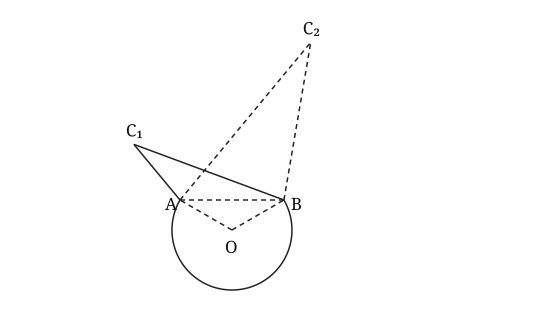<figcaption>Diagram not necessarily drawn to scale</figcaption></figure>

**(a)** Find both possible exact areas of the region. Make clear why both triangles must be considered. **[8]**

**(b)** Determine which design has the greater ratio of area to perimeter. Prove your conclusion without using rounded values. **[4]**

### 答案与解析

略难于 P1-2022-10-Q08：撤掉四问脚手架并保留SSA的两种真实三角形，再将求值升级为面积与周界比的精确证明

**变式来源：** P1-2022-10-Q08。原题大意：大扇形、中心三角形及外接三角形：精确弧形量、弦长和正弦定理组合面积。

**改编维度：** 设问角度、求解目标、条件呈现、题目结构、参数化与分类讨论、收尾要求。

**保留的考点本质：** 弦确定圆心角、大扇形面积与SSA三角形的组合。

**(a) 答案：** $\displaystyle 6\pi+\frac{41\sqrt3}{4}\pm2\sqrt{11}\text{ cm}^2$.

1. 余弦定理在圆心三角形给 $\cos\angle AOB=(9+9-27)/18=-1/2$，故小圆心角为 $2\pi/3$。
2. 大弓形面积为大扇形加中心三角形：$K=\frac12(9)(4\pi/3)+\frac12(9)\sin(2\pi/3)=6\pi+9\sqrt3/4$。
3. 令 $AC=x$。在ABC内以C为夹角用余弦定理：$27=x^2+64-8\sqrt3x$。
4. 解得 $x=4\sqrt3\pm\sqrt{11}$。两者均为正且满足三角形不等式；题目未规定A为锐角，不能删去一种。
5. 三角形面积 $\frac12(8)x\sin(\pi/6)=2x$。
6. 总面积 $K+2x=6\pi+41\sqrt3/4\pm2\sqrt{11}$。

建议评分：M1 [1] 由弦反求正确小圆心角；M1 [1] 大弓形须用大扇形加三角形；A1 [1] 大弓形精确面积正确；M1 [1] 正确建立SSA的边长二次方程；M1 [1] 取得两个可能边长；B1 [1] 解释两三角形均有效；M1 [1] 将三角形与大弓形面积相加；A1 [1] 两种精确面积正确。

**(b) 答案：** $AC=4\sqrt3+\sqrt{11}$ 的设计面积/周界比更大。

1. 外周界不含公共弦AB，故 $P=4\pi+8+x=L+x$；面积为 $K+2x$。
2. 设两边长为 $x_+>x_-$。两个比相减的分子为 $(x_+-x_-)(2L-K)$，分母为 $(L+x_+)(L+x_-)>0$。
3. $2L-K=2\pi+16-9\sqrt3/4>0$，例如用 $\sqrt3<2$ 即得严格正下界。
4. 因此较大的x对应较大的面积/周界比，结论不依赖任何舍入。

建议评分：M1 [1] 建立正确的完整周界和面积比；M1 [1] 作精确交叉相乘比较；B1 [1] 证明比较式严格为正；A1 [1] 正确判定设计。

**易错点与命题思路：**

- 大弓形等于大扇形加三角形，不能相减。
- 没有图示额外限制时，SSA的两根均要检验，不能默认只用较大的三角形。
- 撤掉四问脚手架并保留SSA的两种真实三角形，再将求值升级为面积与周界比的精确证明。保留来源题的弦确定圆心角、大扇形面积与SSA三角形的组合。

## P1-C07-R31 · P1 第7章 · 坐标半径比逆求与扇形区域比较 · 10 marks

The line $l_1$ passes through $A(0,6)$ and $B(b,2)$, where $b>0$. The line $l_2$ is perpendicular to $l_1$ at $B$ and meets the $y$-axis at $C$. A circle with centre $C$ passes through $A$, and the ray $CB$ meets the circle at $D$. Given that $CB:CA=3:\sqrt{13}$, and that $O$ is the origin.<figure class="rewrite-figure">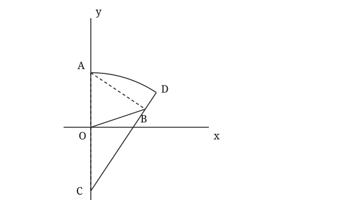<figcaption>Diagram not necessarily drawn to scale</figcaption></figure>

**(a)** Find $b$, the coordinates of $C$ and an equation of $l_2$. **[5]**

**(b)** The region bounded by $OA$, $OB$, $BD$ and the minor arc $DA$ has perimeter $P$ and area $S$. Find $P$ to 3 significant figures and determine whether $S$ is greater than half the area of the sector $ACD$. **[5]**

### 答案与解析

略难于 P1-2021-06-Q07：由几何长度比反推未知横坐标，撤去长度与面积拆分提示，再作面积比例判断

**变式来源：** P1-2021-06-Q07。原题大意：直线截距与垂线重建半径，求扇形弧长及坐标三角形的精确组合面积。

**改编维度：** 设问角度、条件呈现、求解目标、题目结构、跨考点耦合。

**保留的考点本质：** 垂线、坐标长度、弧度角及扇形与三角形的面积组合。

**(a) 答案：** $b=6,\ C=(0,-7),\ l_2:y-2=\frac32(x-6)$.

1. $l_1$斜率为 $-4/b$，故 $l_2:y-2=(b/4)(x-b)$，$C=(0,2-b^2/4)$。
2. $CA=4+b^2/4=(b^2+16)/4$，而 $CB=b\sqrt{b^2+16}/4$。
3. 由 $CB/CA=b/\sqrt{b^2+16}=3/\sqrt{13}$，得 $13b^2=9b^2+144$。
4. 因b>0，取b=6；所以 $C=(0,-7)$，垂线方程为 $y-2=3(x-6)/2$。

建议评分：M1 [1] 正确构造垂线及其截距；M1 [1] 由坐标表达两长度；M1 [1] 正确使用半径比消元；A1 [1] 取得正b及正确C；A1 [1] 垂线方程正确。

**(b) 答案：** $P=22.2$；$S=28.686220\ldots$，大于扇形面积的一半。

1. 由坐标得 $CA=13,CB=3\sqrt{13}$；$\tan\theta=6/9=2/3$，其中 $\theta=\angle ACD$。
2. 外周界为 $6+\sqrt{40}+(13-3\sqrt{13})+13\theta$，不含内部的OC和CB。
3. 扇形面积 $=169\theta/2$；三角形OCB面积 $=7\times6/2=21$。目标面积是扇形减该三角形。
4. 于是 $S=28.68622000\ldots$；半个扇形面积 $24.84311000\ldots$，所以S较大。

建议评分：M1 [1] 正确构造角、半径及BD；M1 [1] 外周界四段正确；A1 [1] 周界数值及精度正确；M1 [1] 不靠题干提示重建面积差；A1 [1] 正确比较与半个扇形面积的大小。

**易错点与命题思路：**

- CB不是圆半径，B在圆内而D在圆上。
- 不能沿用来源的面积相加：本题的目标区域须减去OCB。
- 由几何长度比反推未知横坐标，撤去长度与面积拆分提示，再作面积比例判断。保留来源题的垂线、坐标长度、弧度角及扇形与三角形的面积组合。

## P1-C07-R32 · P1 第7章 · 等周界分区的存在范围与面积证明 · 7 marks

A sector $OAB$ has radius $r>0$ and angle $\theta$ radians, where $0<\theta<\pi$. A point $P$ lies strictly between $O$ and $B$. The line $AP$ divides the sector into triangle $OAP$ and a curved region. The two regions have equal perimeters.<figure class="rewrite-figure">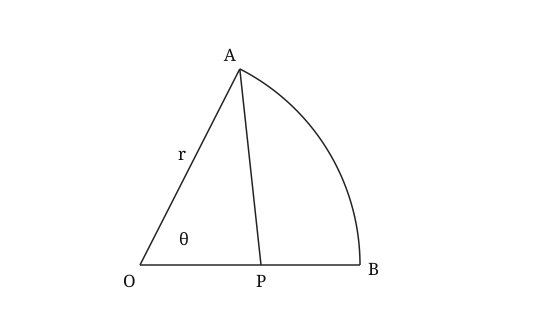<figcaption>Diagram not necessarily drawn to scale</figcaption></figure>

**(a)** Show that such a point $P$ exists if and only if $0<\theta<2$. **[3]**

**(b)** For all the valid values of $\theta$, prove that the curved region has area at least as great as that of the triangle. Find the value of $\theta$ when the two areas are equal. **[4]**

### 答案与解析

略难于 P1-2024-10-Q05：用等周界的隐含条件替代已知面积比，证明分割点存在的充要条件，并对全部有效角证明面积次序及等号情形

**变式来源：** P1-2024-10-Q05。原题大意：扇形被直线分区：给定面积比反求分割点及分割线长度。

**改编维度：** 设问角度、求解目标、条件呈现、参数化与分类讨论、题目结构、收尾要求。

**保留的考点本质：** 扇形和三角形分区的面积与真实边界。

**(a) 答案：** $OP=r\theta/2$；严格在线段内当且仅当 $0<\theta<2$.

1. 令 $OP=x$。三角形周界为 $r+x+AP$，曲边区域周界为 $r\theta+(r-x)+AP$。
2. 两周界相等，共用的AP抵消，得 $2x=r\theta$。
3. $P$严格在线段内要求 $0<x<r$，等价于 $0<\theta<2$；满足此范围时取 $x=r\theta/2$ 即能构造P，故必要性和充分性均成立。

建议评分：M1 [1] 正确写出两区周界；M1 [1] 消去共边得到OP；A1 [1] 证明必要且充分的严格范围。

**(b) 答案：** 曲边区域面积不小于三角形；等号当且仅当 $\theta=\pi/2$.

1. 三角形面积 $T=\frac12rx\sin\theta=\frac14r^2\theta\sin\theta$。
2. 扇形面积为 $F=\frac12r^2\theta$，所以 $T/F=\sin\theta/2\le1/2$。
3. 曲边区域为 $F-T$，故 $F-T\ge T$。
4. 等号要求 $\sin\theta=1$；在 $0<\theta<2$ 中唯一为 $\theta=\pi/2$，且确满足存在范围。

建议评分：M1 [1] 用等周界条件表达三角形面积；A1 [1] 正确取得三角形占扇形的比例；M1 [1] 利用sinθ≤1证明两区面积次序；A1 [1] 等号角及有效性正确。

**易错点与命题思路：**

- 共边AP在比较周界时抵消，但不能从每区周界中直接漏掉。
- θ=2时P=B，违反strictly between，不能包括端点。
- 用等周界的隐含条件替代已知面积比，证明分割点存在的充要条件，并对全部有效角证明面积次序及等号情形。保留来源题的扇形和三角形分区的面积与真实边界。

## P1-C07-R33 · P1 第7章 · 环形扇区的两组设计 · 8 marks

An annular sector has inner radius $r$ cm, outer radius $2r$ cm and angle $\theta$ radians. Its area is $24\text{ cm}^2$ and its complete perimeter is $22$ cm.<figure class="rewrite-figure"><svg xmlns="http://www.w3.org/2000/svg" viewBox="0 0 540 300" role="img" aria-label="An annular sector with two possible designs"><title>An annular sector with two possible designs</title><g fill="none" stroke="#222" stroke-width="1.6"><path d="M270 245L130 125A184 184 0 0 1 410 125L340 185A92 92 0 0 0 200 185Z"/><path d="M200 185L340 185" stroke-dasharray="6 4"/><text x="263" y="268" fill="#222" stroke="none" font-family="Georgia,serif" font-size="16">O</text><text x="112" y="120" fill="#222" stroke="none" font-family="Georgia,serif" font-size="16">A</text><text x="418" y="120" fill="#222" stroke="none" font-family="Georgia,serif" font-size="16">B</text><text x="183" y="183" fill="#222" stroke="none" font-family="Georgia,serif" font-size="16">D</text><text x="347" y="183" fill="#222" stroke="none" font-family="Georgia,serif" font-size="16">C</text></g></svg><figcaption>Diagram not necessarily drawn to scale</figcaption></figure>

**(a)** Show that $r^2-11r+24=0$. **[3]**

**(b)** Find both possible designs $(r,\theta)$. **[2]**

**(c)** Determine which design has the longer outer arc and find the difference between the two outer arc lengths. Explain why the design with the larger inner radius can nevertheless have the shorter outer arc. **[3]**

### 答案与解析

略难于 P1-2023-10-Q09：把单一尺寸改成双解参数问题，并要求解释反直觉的弧长比较

**变式来源：** P1-2023-10-Q09。原题大意：环形扇区：由面积关系建立尺寸方程并求完整周界。

**改编维度：** 设问角度、参数化与分类讨论、求解目标、收尾要求。

**保留的考点本质：** 环形面积与完整边界共同产生两组有效设计。

**(a) 答案：** $r^2-11r+24=0$.

1. $24=\tfrac12(4r^2-r^2)\theta=\tfrac32r^2\theta$，所以 $r\theta=16/r$。
2. 两弧总长为 $3r\theta=48/r$，两条径向边总长为 $2r$。
3. $48/r+2r=22$，整理得 $r^2-11r+24=0$。

建议评分：M1 [1] Uses the annular area；M1 [1] Builds the complete perimeter；A1 [1] Obtains the quadratic。

**(b) 答案：** $(3,16/9)$ and $(8,1/4)$.

1. $(r-3)(r-8)=0$。
2. 由 $\theta=16/r^2$ 得两组设计 $(3,16/9)$、$(8,1/4)$，两角都在 $(0,\pi)$ 内。

建议评分：M1 [1] Solves for both positive radii；A1 [1] Finds both angles。

**(c) 答案：** $r=3$的设计外弧较长，相差 $20/3$ cm。$r=8$的设计角较小，因此其外弧较短。

1. 外弧长为 $2r\theta=32/r$，两组分别为 $32/3$ 和 $4$ cm，相差 $20/3$ cm。
2. 虽然内半径从 $3$ 增到 $8$，角度却从 $16/9$ 降到 $1/4$。
3. 弧长取决于半径与角度的乘积，因此大半径方案反而可能有较短外弧。

建议评分：M1 [1] 用2rθ表达并比较两外弧；A1 [1] 两外弧和精确差值20/3正确；B1 [1] 说明较大r对应的θ下降使乘积更小。

**易错点与命题思路：**

- 周界含两条弧和两条宽度
- 大半径不必对应大弧长。
- 把单一尺寸改成双解参数问题，并要求解释反直觉的弧长比较

## P1-C07-R34 · P1 第7章 · 弧弦交替图形的单元数逆求 · 9 marks

A shape is cut from a circular disc of radius $r$ cm. Its outside boundary consists of $n$ equal minor arcs alternating with $n$ equal chords, all with endpoints on the disc. The arcs and chords occur in this order around the circumference, and the cut-outs are the minor segments between the chords and the original circle. Each chord has length $r$. The total length of the retained arcs is half the circumference of the original disc. The perimeter of the shape is $(6\pi+18)$ cm.<figure class="rewrite-figure">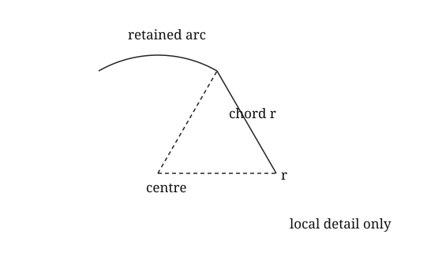<figcaption>Diagram not necessarily drawn to scale</figcaption></figure>

**(a)** Show that $n=3$ and find $r$. **[4]**

**(b)** Three congruent minor sectors, each of angle $\pi/3$, have total area equal to the material removed from the disc. Find the sum of their perimeters, giving your answer to 3 significant figures. **[5]**

### 答案与解析

略难于 P1-2022-06-Q08：先由弦长及半周条件反推单元数量，再将切除弓形总面积逆向转成独立扇形的完整周界

**变式来源：** P1-2022-06-Q08。原题大意：重复圆弧单元组成的风扇：整周关系、外边界和重复单元总面积。

**改编维度：** 设问角度、条件呈现、求解目标、题目结构、跨考点耦合、收尾要求。

**保留的考点本质：** 重复单元的整周分配、圆弧与径向边界和面积。

**(a) 答案：** $n=3,\quad r=6\text{ cm}$.

1. 弦与两半径形成等边三角形，所以每个切去弓形对应小圆心角为 $\pi/3$。
2. 保留弧占半周，剩下的n段被弦替代的原弧也占半周，因此 $n(\pi/3)=\pi$，得n=3。
3. 保留弧总长 $\pi r$，三条外露弦共长3r；没有外露的半径边。
4. 由 $r(\pi+3)=6\pi+18$ 得r=6。

建议评分：B1 [1] 由弦等于半径得π/3；M1 [1] 利用半周条件确定单元数；M1 [1] 正确建立弧与弦组成的外周界；A1 [1] 取得n和正半径。

**(b) 答案：** $22.8$ cm。

1. 被切去总面积为 $3[\frac12(6)^2(\pi/3-\sin(\pi/3))]=18\pi-27\sqrt3$。
2. 设新扇形半径为ρ，三扇形总面积为 $3(\frac12\rho^2\pi/3)=\pi\rho^2/2$。
3. 令面积相等，得 $\rho=6\sqrt{1-3\sqrt3/(2\pi)}$，取正根。
4. 三个扇形是三个独立图形，须各计两条半径；总周界 $=3\rho(2+\pi/3)=\rho(6+\pi)$。
5. 代入未舍入的半径得 $22.81416209\ldots$ cm，取3位有效数字。

建议评分：M1 [1] 正确构造重复弓形的移除总面积；A1 [1] 精确移除面积正确；M1 [1] 从相等面积逆求新正半径；M1 [1] 计入三个独立扇形的全部径向边；A1 [1] 总周界数值及精度正确。

**易错点与命题思路：**

- 原图形的圆心连线都是内部辅助线，不能加进周界。
- 新扇形互相独立，六条半径必须计入，不能沿用原图的边界规则。
- 先由弦长及半周条件反推单元数量，再将切除弓形总面积逆向转成独立扇形的完整周界。保留来源题的重复单元的整周分配、圆弧与径向边界和面积。

## P1-C07-R37 · P1 第7章 · 坐标扇形的截轴临界角与面积 · 9 marks

The line $l_1$ has equation $3x+4y=4a$, where $a$ is a positive constant. It meets the $y$-axis at $C$. The point $D(8,a-6)$ lies on $l_1$. The line $l_2$ is perpendicular to $l_1$ at $D$ and meets the $y$-axis at $E$. The origin $O$ lies strictly between $E$ and $C$. The area of triangle $ODE$ is one third of the area of triangle $CDE$.<figure class="rewrite-figure">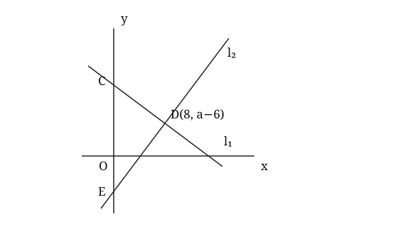<figcaption>Diagram not necessarily drawn to scale</figcaption></figure>

**(a)** Find $a$ and the radius of the circle with centre $C$ passing through $E$. **[4]**

**(b)** A sector with centre $C$ and radius $CE$ lies to the left of the $y$-axis. Starting from ray $CE$, its angle is $\theta$ radians, where $0<\theta<\pi$. Find the least value of $\theta$ for which this sector contains the whole part of the left half-disc lying below the $x$-axis. Find the area of that part, giving your answer to 3 significant figures. **[5]**

### 答案与解析

略难于 P1-2021-06-Q07：由三角形面积比反求平移参数，再构造扇形包含截轴区域的最小角及截轴面积

**变式来源：** P1-2021-06-Q07。原题大意：坐标直线及垂线截距确定扇形半径，求弧长与组合区域精确面积。

**改编维度：** 设问角度、求解目标、条件呈现、参数化与分类讨论、题目结构、收尾要求。

**保留的考点本质：** 坐标截距和垂线重建半径，再将扇形与三角形面积相连。

**(a) 答案：** $a=100/9$，半径 $CE=50/3$.

1. 垂线斜率为4/3，故 $l_2:y-(a-6)=4(x-8)/3$，$E=(0,a-50/3)$；$C=(0,a)$。
2. 因此 $CE=50/3$ 与a无关。两三角形以y轴上的边为底，同高8，面积比等于 $OE:CE$。
3. 因E在原点下方，$OE=50/3-a$；由 $(50/3-a)/(50/3)=1/3$，得 $a=100/9$。
4. 验证 $E_y=-50/9<0<C_y=100/9$，半径为50/3。

建议评分：M1 [1] 求垂线的截距；A1 [1] 取得不随a改变的半径；M1 [1] 以共同高把面积比转为有向长度条件；A1 [1] 解得a并核对原点位置。

**(b) 答案：** 最小角 $=\cos^{-1}(2/3)=0.841069\ldots$ rad；面积 $47.8$ 平方单位。

1. 设圆与负x轴交于X。临界位置是扇形末端半径CX恰经过X；在这之后，左半圆盘中x轴以下的部分全部包含在扇形内。
2. $\cos\angle ECX=CO/CE=(100/9)/(50/3)=2/3$，故最小角为 $u=\cos^{-1}(2/3)$。
3. 横向距离 $OX=\sqrt{(50/3)^2-(100/9)^2}=50\sqrt5/9$。
4. 目标区域面积为扇形CEX减三角形COX，即 $\frac12(50/3)^2u-\frac12(100/9)(50\sqrt5/9)$。
5. 所得面积 $=47.80064938\ldots$ 平方单位；临界角属于(0,π)，可实际达到。

建议评分：B1 [1] 识别临界半径经过负x轴交点；M1 [1] 通过坐标垂距构造临界角；A1 [1] 临界角及可达到性正确；M1 [1] 自行构造扇形减三角形的截轴面积；A1 [1] 面积与3位有效数字正确。

**易错点与命题思路：**

- E_y为负，OE=−E_y，不能把有向坐标直接当长度。
- x轴下方区域是扇形减三角形，不是半个整扇形。
- 由三角形面积比反求平移参数，再构造扇形包含截轴区域的最小角及截轴面积。保留来源题的坐标截距和垂线重建半径，再将扇形与三角形面积相连。

## P1-C07-R38 · P1 第7章 · 含参垂线的最小半径与剩余边界 · 10 marks

The line $l_1$ passes through $A(0,a)$ and $D(6,2)$, where $a>2$. The line $l_2$ is perpendicular to $l_1$ at $D$ and meets the $y$-axis at $E$. The origin $O$ lies strictly between $E$ and $A$. A circle with centre $E$ passes through $A$.<figure class="rewrite-figure">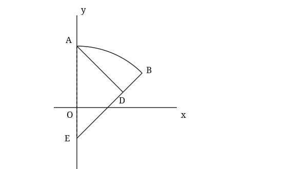<figcaption>Diagram not necessarily drawn to scale</figcaption></figure>

**(a)** Find the permitted range of $a$. Without differentiation, prove that the circle has radius at least $12$, and find $a$ when equality holds. **[5]**

**(b)** For this minimum-radius circle, ray $ED$ meets the circle at $B$. A region is bounded by $AD$, $DB$ and the minor arc $BA$. Find the exact area and perimeter of this region. **[5]**

### 答案与解析

略难于 P1-2021-06-Q07：把固定直线改为几何有效区间中的参数族，用平方证明最小半径，再自行确定圆内线段和弧形剩余边界

**变式来源：** P1-2021-06-Q07。原题大意：直线与垂线的截距给出扇形半径，再求圆弧与三角形组合面积。

**改编维度：** 设问角度、求解目标、条件呈现、参数化与分类讨论、题目结构、收尾要求。

**保留的考点本质：** 垂直斜率、截距、圆半径和三角形与扇形的组合。

**(a) 答案：** $2<a<20$；半径 $\ge12$，等号当 $a=8$.

1. 令 $t=a-2>0$。垂线斜率为 $6/t$，故 $E_y=2-36/t$。
2. 原点在线段EA内部要求 $E_y<0$，因此 $t<18$，即 $2<a<20$。
3. 半径 $EA=a-E_y=t+36/t$。
4. 因为 $t>0$，$EA-12=(t-6)^2/t\ge0$；不需要用微分。
5. 等号在t=6即a=8成立，且该a在允许区间内。

建议评分：M1 [1] 正确表达垂线截距；A1 [1] 求出严格参数范围；M1 [1] 正确构造半径的含参表达式；M1 [1] 用非负平方证明最小值；A1 [1] 等号参数及有效性正确。

**(b) 答案：** 面积 $18\pi-36$ 平方单位；周界 $12+3\pi$ 单位。

1. 此时 $A=(0,8),E=(0,-4),D=(6,2)$，$EA=12$；ED方向的横纵增量均为6，所以 $\angle AEB=\pi/4$。
2. 扇形面积 $=\frac12(12)^2(\pi/4)=18\pi$。三角形AED面积 $=\frac12(12)(6)=36$；目标为两者之差。
3. $AD=ED=6\sqrt2$；D在圆内，故 $DB=12-6\sqrt2$。
4. 周界三段之和 $AD+DB+\text{arc }BA=6\sqrt2+(12-6\sqrt2)+12(\pi/4)=12+3\pi$。

建议评分：B1 [1] 由坐标确定π/4角；M1 [1] 构造正确的面积差；A1 [1] 精确面积正确；M1 [1] 用D在圆内识别DB并构造边界；A1 [1] 化简得到精确周界。

**易错点与命题思路：**

- 必须先验证t>0才能将非负平方除以t。
- DB=EB−ED，不能把ED直接作为外边界。
- 把固定直线改为几何有效区间中的参数族，用平方证明最小半径，再自行确定圆内线段和弧形剩余边界。保留来源题的垂直斜率、截距、圆半径和三角形与扇形的组合。

